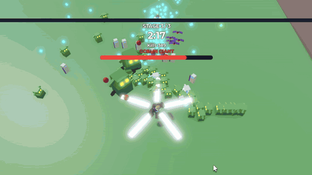

# Roblox Survivor Roguelite

A fantasy survivor-like roguelite for Roblox, played solo or in co-op with up to 4 players. You move with one thumb while your weapons fire on their own. You collect XP gems, choose 1 of 3 upgrades at each level-up, and combine them into evolved weapons. A run is three short stages that ends in a boss fight. Between runs you spend Shards on permanent upgrades and new heroes.

<!-- TODO: add a gameplay GIF or screenshots here, e.g.  -->

**Status:** in active development. Milestones M0–M3 are done (solo loop, co-op, meta progression), and M4 (content and polish) is in progress. Full design: [`docs/design.md`](docs/design.md).

## Features

- **Run loop:** 3 stages of about 3 minutes each. Each stage ends in overtime, where a portal opens and the party has to stand in it to charge it while spawns ramp up. Stage 3 ends with an **Ogre boss** that has telegraphed attacks: shot rings, summons, and a charge down a marked lane. It enrages at low HP.
- **Build crafting:** weapons (Spinning Blade, Volley Arrows, Fireball) and passives (Might, Haste, Swiftness, Reach, Vitality, Magnet), each with 5 levels. A maxed weapon plus its paired passive evolves into **Bladestorm**, **Arrow Storm** or **Meteor**.
- **Enemies:** goblins, bat swarms, skeleton archers that keep their distance and shoot, a Goblin Giant mini-boss, elite variants that drop chests, and breakable supply crates.
- **Co-op for 1–4 players:** parties form on a lobby portal pad, and each party gets its own arena instance. XP is shared, and level-ups pause the whole party so everyone picks at once. A 15-second limit auto-picks for idle players. Players get downed instead of dying and can be revived by teammates. Difficulty scales with party size.
- **Meta progression:** Shards are earned on every run, win or lose. You spend them at the Altar on 8 permanent upgrades or on unlocking heroes (Knight, Ranger, Pyromancer, each with its own starting weapon and passive). Saves use session-locked DataStores.

## Technical highlights

The game has to keep **100–200 enemies** alive at once and still run on phones, which shaped most of the architecture.

- **The server runs the simulation and clients only draw.** Enemies, projectiles and XP gems are plain Luau data on the server, not Parts or Humanoids. One `Heartbeat` loop steps every match in a fixed order (`src/server/Match.luau`).
- **Binary enemy replication.** Enemy positions go out at about 20 Hz as packed `buffer`s over an `UnreliableRemoteEvent` (10 bytes per enemy, split to stay under the packet size limit). Clients pool primitive models and interpolate 100 ms behind (`src/shared/EnemySnapshot.luau`, `src/client/EnemyRenderer.luau`).
- **Low-bandwidth projectiles and gems.** Projectiles send only a spawn event, and clients compute the straight-line path themselves. A removal event goes out only if a projectile stops early. Gems send just spawn and collected events.
- **Spatial hashing for hits.** Collision checks use a uniform grid (`src/server/SpatialHash.luau`) instead of `.Touched`.
- **Pausable game clock.** All gameplay timing reads a clock that subtracts time spent paused (`src/shared/GameClock.luau`). That covers stage timers, cooldowns, projectile flight and weapon orbits. Pausing for a co-op level-up freezes everything consistently on the server and every client.
- **Per-match state objects.** Every run system is created with `Module.new(...)` per match, so several parties can play in separate arenas on one server.
- **Batched, ordered networking.** Each frame's events for a match are collected and sent once per remote, in a fixed order, so a "spawned" event always arrives before its matching "despawned" event (`src/server/NetBatch.luau`).
- **Shared stat math.** One module turns a build into stats for both server hit logic and client visuals, so they never drift apart (`src/shared/BuildStats.luau`).
- **Exploit-resistant by design.** Every remote handler validates argument types and ranges and is rate-limited. Purchases check the price and spend inside a single atomic data update.
- **Safe persistence.** `src/server/PlayerData.luau` handles session locking, retries with exponential backoff, autosave, and saving on `PlayerRemoving` and `BindToClose`.
- **Data-driven tuning.** Weapons, enemies, waves, scaling and costs all live in `src/shared/Config/`.

## Project structure

The code lives on disk and is synced into Roblox Studio with [Rojo](https://rojo.space). The arena, lobby, enemy models and UI are all built in code, so the repo is the whole game and no place file is needed.

```
src/
  server/   -> ServerScriptService.Server       simulation, matches, lobby, waves, weapons, data
  client/   -> StarterPlayerScripts.Client      renderers, camera, UI
  shared/   -> ReplicatedStorage.Shared         config, wire formats, shared math, remotes
docs/
  design.md                                    game design doc and milestones
default.project.json                           Rojo project (how src/ maps onto the DataModel)
```

All code is `--!strict` Luau (about 9,300 lines), formatted with StyLua and linted with Selene.

## Building and running

Requires [Rokit](https://github.com/rojo-rbx/rokit) and Roblox Studio with the Rojo plugin.

```bash
rokit install              # installs the pinned Rojo, StyLua and Selene
rojo build -o build.rbxl   # build a place file, then open it in Studio
rojo serve                 # live-sync src/ into Studio (click Connect in the Rojo plugin)
```

Press Play in Studio, walk onto the portal pad in the lobby, and the run starts after the countdown. To save data in Studio, turn on "Enable Studio Access to API Services". Without it, the game falls back to unsaved defaults.

```bash
stylua src   # format
selene src   # lint
```

## Development process

Built with [Claude Code](https://claude.com/claude-code) as an AI pair programmer. Work follows the design doc in milestones: each feature is planned, implemented, verified in Studio, and then playtested, including 2-player co-op sessions, before moving on. [`CLAUDE.md`](CLAUDE.md) holds the project conventions and architecture notes used during development.
