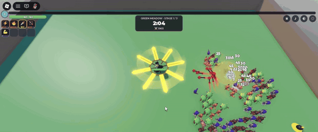

# Roblox Survivor Roguelite

[](https://github.com/ChugJugDude/roblox-survivor-roguelite/actions/workflows/lint.yml)

A fantasy survivor-like roguelite for Roblox, played solo or in co-op with up to 4 players. You move with one thumb while your weapons fire on their own. You collect XP gems, choose 1 of 3 upgrades at each level-up, and combine them into evolved weapons. A run is three short stages that ends in a boss fight. Between runs you spend Shards on permanent upgrades and new heroes.



**Status:** in active development. Milestones M0–M4 are done (solo loop, co-op, meta progression, content and polish). M5 (progression) is underway: the world system with a second world, the Volcano, and a full visual upgrade (AI-generated models, animation, boss wind-ups) are in; map polish, a third world, gear and lobby loot chests are next. Full design: [`docs/design.md`](docs/design.md).

## Features

- **Run loop:** 3 stages of about 3 minutes each. Each stage ends in overtime, where a portal opens and the party has to stand in it to charge it while spawns ramp up. Stage 3 ends with a boss that has telegraphed attacks: shot rings, summons, and a charge down a marked lane. It enrages at low HP.
- **Worlds:** beating the **Green Meadow** and its Ogre unlocks the **Volcano**: a lava-cracked arena with its own lighting, tougher enemies (fire imps, magma hound packs, ember archers, a Magma Golem), 1.5x Shards, and the **Infernal**, whose Eruption attack bursts red circles under the players. The party leader picks the world on the portal pad, and friends can be carried.
- **Build crafting:** 6 weapons (Spinning Blade, Volley Arrows, Fireball, Chain Lightning, Frost Nova, Holy Ground) and 9 passives (Might, Haste, Swiftness, Reach, Vitality, Magnet, Armor, Regen, Warding), each with 5 levels. A maxed weapon plus its paired passive evolves: **Bladestorm**, **Arrow Storm**, **Meteor**, **Thunderstorm**, **Blizzard** (freezes enemies solid) or **Sanctuary** (zones that heal the whole party). Warding's orbiting rings destroy enemy shots.
- **Enemies:** goblins, bat swarms, skeleton archers that keep their distance and shoot, a Goblin Giant mini-boss, elite variants that drop chests, and breakable supply crates, plus the Volcano's roster.
- **Models and animation:** every enemy and boss is an AI-generated low-poly model (made with Roblox Studio's mesh generator), animated in code: walk cycles that match each enemy's speed, a strike when a contact hit lands, wings that flap, and archers that raise a bow, draw the string back to a nocked bolt and let fly. Bosses telegraph every big attack with a pose and a sound: rearing back before a charge, raising both arms before an eruption, gathering then flinging their arms wide as a ring of shots fires.
- **Co-op for 1–4 players:** parties form on a lobby portal pad, and each party gets its own arena instance. XP is shared, and level-ups pause the whole party so everyone picks at once. A 15-second limit auto-picks for idle players. Players get downed instead of dying and can be revived by teammates. Difficulty scales with party size.
- **Game feel:** licensed sound effects and music (lobby, run and boss tracks) with mute buttons and per-weapon volume sliders; hit sparks, death puffs and damage numbers; weapons that look like what they are (orbiting greatswords with swing trails that turn to glowing gold when they evolve, fletched arrows, flaming fireballs, tumbling molten meteors, lightning that sparks where it strikes, frozen enemies encased in ice, Holy Ground as a rune circle cast up from the ground); enemy shots are crimson bolts and energy orbs with trails, so they always read as danger; a themed, mobile-first UI with build tiles, health bars and upgrade cards.
- **Meta progression:** Shards are earned on every run, win or lose. You spend them at the Altar on 8 permanent upgrades or on unlocking heroes (Knight, Ranger, Pyromancer, each with its own starting weapon and passive). Saves use session-locked DataStores.

## Technical highlights

The game has to keep **100–200 enemies** alive at once and still run on phones, which shaped most of the architecture.

- **The server runs the simulation and clients only draw.** Enemies, projectiles and XP gems are plain Luau data on the server, not Parts or Humanoids. One `Heartbeat` loop steps every match in a fixed order (`src/server/Match.luau`).
- **Binary enemy replication.** Enemy positions go out at about 20 Hz as packed `buffer`s over an `UnreliableRemoteEvent` (10 bytes per enemy, split to stay under the packet size limit). Clients pool enemy models and interpolate 100 ms behind (`src/shared/EnemySnapshot.luau`, `src/client/EnemyRenderer.luau`).
- **AI models kept as data.** Models are generated in Studio, normalized (squared up, facing forward, scaled, parts tagged for animation) and exported by a script into a Luau config of mesh and texture IDs, sizes and offsets (`tools/`, `src/shared/Config/Models.luau`). The client rebuilds them at startup with `AssetService:CreateMeshPartAsync`, so the whole game still lives in git, and code-built models stand in until they load.
- **Procedural animation at crowd scale.** No Humanoids or Animators: each enemy's pose (walk cycle driven by distance moved, strikes, boss wind-ups, the archer's bow rig) is a few CFrame multiplications folded into the renderer's single `BulkMoveTo` per frame (`src/client/EnemyAnimation.luau`). Server events say when a hit lands or an attack winds up, so the animation lines up with the damage.
- **Low-bandwidth projectiles and gems.** Projectiles send only a spawn event, and clients compute the straight-line path themselves. A removal event goes out only if a projectile stops early. Gems send just spawn and collected events.
- **Spatial hashing for hits.** Collision checks use a uniform grid (`src/server/SpatialHash.luau`) instead of `.Touched`.
- **Pausable game clock.** All gameplay timing reads a clock that subtracts time spent paused (`src/shared/GameClock.luau`). That covers stage timers, cooldowns, projectile flight and weapon orbits. Pausing for a co-op level-up freezes everything consistently on the server and every client.
- **Per-match state objects.** Every run system is created with `Module.new(...)` per match, so several parties can play in separate arenas on one server.
- **Batched, ordered networking.** Each frame's events for a match are collected and sent once per remote, in a fixed order, so a "spawned" event always arrives before its matching "despawned" event (`src/server/NetBatch.luau`).
- **Effects that scale with the crowd.** Visuals are client-only and driven by events the client already gets. Particle bursts reuse one emitter per effect, moved and `Emit`ted in place; damage numbers come from a fixed pool and merge per enemy; each sound plays at most once per minimum interval, so 50 hits in a frame make one sound (`src/client/Particles.luau`, `HitEffects.luau`, `SoundPlayer.luau`). In Studio, 200 animated AI-model enemies (with both bosses) hold 60 fps on the client and 60 Hz on the server on both graphics settings, and so does every evolution at once killing about 70 enemies a second.
- **Shared stat math.** One module turns a build into stats for both server hit logic and client visuals, so they never drift apart (`src/shared/BuildStats.luau`).
- **Server-side Validation.** Every remote handler validates argument types and ranges and is rate-limited. Purchases check the price and spend inside a single atomic data update.
- **Safe persistence.** `src/server/PlayerData.luau` handles session locking, retries with exponential backoff, autosave, and saving on `PlayerRemoving` and `BindToClose`.
- **Data-driven tuning.** Weapons, enemies, waves, worlds, scaling and costs all live in `src/shared/Config/`. A new world is a config entry (stages, colors, lighting, enemy mix, boss) plus models.

## Project structure

The code lives on disk and is synced into Roblox Studio with [Rojo](https://rojo.space). The arena, lobby and UI are built in code and the AI models are stored as data, so the repo is the whole game and no place file is needed.

```
src/
  server/   -> ServerScriptService.Server       simulation, matches, lobby, waves, weapons, data
  client/   -> StarterPlayerScripts.Client      renderers, camera, UI
  shared/   -> ReplicatedStorage.Shared         config, wire formats, shared math, remotes
tools/                                         Studio scripts for turning AI generations into model data
docs/
  design.md                                    game design doc and milestones
default.project.json                           Rojo project (how src/ maps onto the DataModel)
```

All code is `--!strict` Luau (about 17,000 lines), formatted with StyLua and linted with Selene.

## Building and running

Requires [Rokit](https://github.com/rojo-rbx/rokit) and Roblox Studio with the Rojo plugin.

```bash
rokit install              # installs the pinned Rojo, StyLua and Selene
rojo build -o build.rbxl   # build a place file, then open it in Studio
rojo serve                 # live-sync src/ into Studio (click Connect in the Rojo plugin)
```

Press Play in Studio, walk onto the portal pad in the lobby, and the run starts after the countdown. To save data in Studio, turn on "Enable Studio Access to API Services". Without it, the game falls back to unsaved defaults.

```bash
stylua src   # format
selene src   # lint
```

## Development process

Built with [Claude Code](https://claude.com/claude-code) as an AI pair programmer. Work follows the design doc in milestones: each feature is planned, implemented, verified in Studio, and then playtested, including 2-player co-op sessions, before moving on. [`CLAUDE.md`](CLAUDE.md) holds the project conventions and architecture notes used during development.
